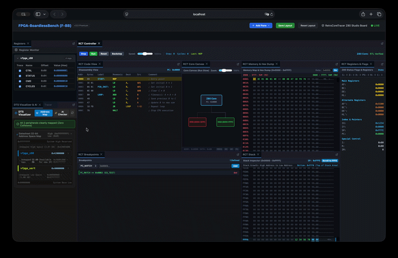
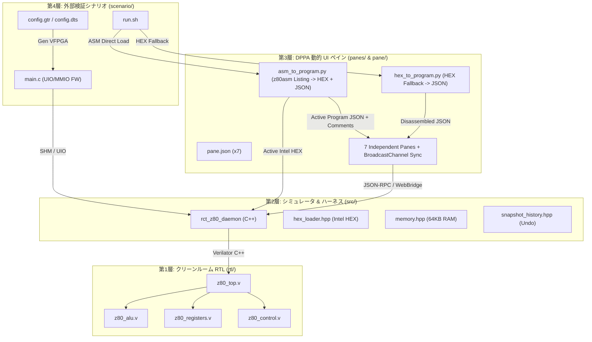

# RetroCoreTracer for F-BB (RetroCoreTracer-FBB)

**RetroCoreTracer-FBB** は、[FPGA-BoardlessBench (F-BB)](https://github.com/sirosiro/FPGA-BoardlessBench) の **PPA 5.1 (Peripheral Plugin Architecture)** および **DPPA v1.0 (Dashboard Pane Plugin Architecture)** を実証・ドッグフーディングするために開発された、外部独立型の Z80 CPU RTL ビジュアルトレーサー＆スタジオプラグインです。

クリーンルーム（完全スクラッチ）から設計された Verilog-2001 Z80 CPU コア、C++ サイクルシミュレータ、決定論的タイムトラベル（Undo / Backstepping）エンジン、Z80 アセンブラ (`.asm`) 直接読込＆リスティング連動 Code View エンジン、動的 Intel HEX デコーダ、および Dockview に自由に配置可能な 7 個の独立した動的 UI ペイン（DPPA）を提供します。F-BB 本体のコードを 1 行も変更することなく、完全なプラグアンドプレイを実現しています。



---

## 主な特徴 (Key Features)

1. **クリーンルーム自作 Verilog-2001 RTL (100% MIT ライセンス)**:
   - 既存の GPL / LGPL 実装（TV80 や T80 等）に一切依存せず、ゼロベースから命令デコーダ・ALU・レジスタファイルを構築。知的財産権の懸念がなく、教材・商用利用にも最適です。
   - バス光彩（Bus Glow）用プローブピンおよびスナップショット状態復元ポート（Undo ポート）をハードウェアレベルでネイティブ装備。

2. **決定論的タイムトラベル (Backstepping / Undo)**:
   - リングバッファによる `SnapshotHistory` を備え、命令サイクルごとの全レジスタ・フラグ・バス信号・PC を完全保存。
   - 実行済みのサイクルを過去方向へ巻き戻すバックステップ（タイムトラベル実行）をサポート。

3. **リアルタイム Bus Glow (バス光彩アニメーション)**:
   - MREQ, IORQ, RD, WR, M1 などの制御信号およびアドレス/データバスの活性状態を SVG で動的に可視化。
   - ズームイン/アウト・リセット機能を備えたインタラクティブなコア・キャンバス。

4. **DPPA v1.0 準拠 7 分割マルチペイン・スタジオ UI & 統合ペイン**:
   - `BroadcastChannel ('fbb_rct_sync')` および共有ステートストアを介して、全ペインが完全リアルタイムに双方向同期。
   - **RCT Controller (Top Toolbar)**: Step, Backstep, Run, Stop, Reset, クロック周波数（スピード）調整スライダー。
   - **RCT Code View**: 構造化逆アセンブルリスト（Addr, Bytes, Label, Mnemonic, Dest, Src, Comment）と実行中 PC 行の追従ハイライト。
   - **RCT Core Canvas**: Bus Glow SVG 動的バス光彩アニメーション、インタラクティブ・ズーム操作。
   - **RCT Registers & Flags**: メインレジスタ (AF, BC, DE, HL)、裏レジスタ (AF', BC', DE', HL')、インデックス (IX, IY)、特殊レジスタ (SP, PC, I, R, IM)、各フラグ (S, Z, H, PV, N, C)、更新ハイライトバッジ（`[POPPED]`, `[LOADED]` 等）。
   - **RCT Stack**: Z80 規約準拠スタックポインタ（初期値 `0x0000` / プレデクリメントにより `0xFFFE..0xFFFF` に配置）、プッシュ・ポップ・サブルーチン呼出階層追従、リアルタイム Hex/ASCII インスペクタ。
   - **RCT Memory Map & Hex Viewer**: 64KB メモリアドレス空間の領域別カラービジュアライザおよびリアルタイム Hex / ASCII ダンプビュー。
   - **RCT Breakpoints**: PC アドレス一致（PC_MATCH）等のブレークポイント登録・管理・ヒット時自動停止。

5. **Z80 アセンブラソース (`.asm`) 直接読込＆リスティング連動 Code View (コメント・設計意図の完全保持)**:
   - `fbb lab scenario/ my_code.asm` や `./start_lab.sh` に Z80 アセンブラソース (`.asm`) を直接指定して即時実行可能。
   - オープンソースの高速 Z80 クロスアセンブラ `z80asm`（または `pasmo`）と自動連携し、1 パスでシミュレータ用 Intel HEX (`/tmp/rct_active.hex`) とリッチな構造化プログラム JSON (`/tmp/rct_active_program.json`) を同時生成。
   - 従来の「HEX 逆アセンブル」では消失していたブロック設計メモ、行コメント（`; ...`）、空行、ラベル定義を Code View 上に完全再現。コメント行はイタリック・グレー表示で全幅結合し、コードリーディング性を大幅に向上。
   - `INCLUDE "other.asm"` による複数ファイル分割・モジュール構成にも完全対応（リスティング出力の `# File ...` ヘッダー境界を自動認識し、ファイルセパレーターとして UI 描画）。
   - ラベル定義行やコメント行がステップ実行やジャンプ先の計算に干渉しない非同期パース構造を採用。
   - 従来の `.hex` 指定時も自動で構造化逆アセンブラ (`scripts/hex_to_program.py`) が起動する 100% の後方互換性を保証。
   - ラベル優先検索・16進絶対アドレスパース・相対オフセット厳密計算 `(PC + 命令長 + offset) & 0xFFFF` を備えた高精度分岐エンジン（`JR`, `JP`, `DJNZ`, `CALL`, `RET`）。
   - スタック操作（`PUSH`, `POP`）および ALU 演算（`ADD`, `SUB`, `INC`, `DEC`）の完全なフラグ・レジスタ連動。

6. **F-BB コア非侵襲アーキテクチャ (Zero Core Modification)**:
   - `~/.fbb/plugins/fbb-plugin-rct-z80` のシンボリックリンクにより F-BB 側にプラグインとして自動登録。
   - `bin/fbb plugin list`、`bin/fbb plugin validate`、`bin/fbb test`、および `./start_lab.sh` からシームレスに認識・起動。

7. **F-BB 標準 Register Monitor / Register State Tracer 完全統合**:
   - Z80 の全 17 レジスタ（Control/Status, PC, SP, AF, BC, DE, HL, IX, IY, FLAGS, AF', BC', DE', HL'）を F-BB の UIO MMIO 共有メモリ（`/tmp/vfpga_z80`）へ完全マッピング。
   - F-BB 標準の `Register Monitor` ペインおよび波形アナライザ `Register State Tracer` ペインとゼロ遅延で完全連動。

8. **TIME-TRAVEL 連動＆非破壊インスペクション・インターロック**:
   - Tracer 上の波形クリックやシークにより、`fbb_dashboard_sync` を介して Z80 の全レジスタ・フラグが過去スナップショットに自動追従。
   - 過去状態のシーク中に誤って新規スナップショットや MMIO 書き込みが再生成されるのを防ぐバックフロー・インターロックを完備。

9. **HALT 命令自動検知＆無駄なサイクル進行防止**:
   - `HALT` 命令に到達した時点で自動的にタイマーとサイクルカウントを即時停止（`CPU HALTED`）し、プログラム終了後の不要なクロック増加やトレーサー履歴の汚染を防止。

10. **GTR サブグループ化による整理された Register Monitor レイアウト**:
    - `scenario/config.gtr` にて `Control & Status`, `Main Registers`, `Alternate Registers` に論理分割し、F-BB ダッシュボード上でスクロール不要の美しいマルチカラムカード配置を実現。

---

## 4層アーキテクチャ (4-Layer Architecture)



- **第1層: ハードウェア RTL 層 (`rtl/`)**: Verilog-2001 準拠の Z80 プロセッサコア。Verilator によるサイクル精度シミュレーションを前提に最適化。
- **第2層: シミュレータ＆ハーネス層 (`src/`)**: 64KB RAM、Intel HEX パーサ、スナップショット履歴バッファ、UNIX ソケット / JSON-RPC 通信デーモン。
- **第3層: DPPA 動的ペイン層 (`panes/`, `pane/`, `scripts/`)**: F-BB ダッシュボードの Dockview にホットマウントされる React ESM コンポーネント群（7 分割ペイン＋統合ペイン）、Z80 アセンブラリスティング連動パーサ (`asm_to_program.py`)、および動的逆アセンブルスクリプト (`hex_to_program.py`)。
- **第4層: 外部検証シナリオ層 (`scenario/`)**: F-BB の GTR/DTS (`config.gtr` / `config.dts`)、C-Shim、UIO ドライバと連携するエンドツーエンド検証環境。

---

## ディレクトリ構成 (Directory Structure)

```text
RetroCoreTracer-FBB/
├── ARCHITECTURE_MANIFEST.md    # 憲法・設計マニフェスト (ADR #001〜#003 収録)
├── CMakeLists.txt              # Verilator RTL + C++ ハーネス統合ビルド定義
├── fbb-plugin.json             # F-BB PPA 5.1 プラグインマニフェスト
├── README.md                   # 本ドキュメント
├── rtl/                        # クリーンルーム Verilog RTL
│   ├── README.md               # RTL アーキテクチャ・ステートマシン仕様書
│   ├── z80_top.v               # トップモジュール (プローブピン・Undoポート)
│   ├── z80_alu.v               # 8-bit ALU (S/Z/H/PV/N/C 完全フラグ演算)
│   ├── z80_registers.v         # レジスタファイル (裏レジスタ・IX/IY・プローブ)
│   └── z80_control.v           # 命令デコーダ & サイクル実行ステートマシン
├── src/                        # C++ シミュレーションハーネス & デーモン
│   ├── hex_loader.hpp          # Intel HEX ファイルパーサ
│   ├── memory.hpp              # 64KB 同期 RAM モデル
│   ├── snapshot_history.hpp    # 決定論的タイムトラベル用リングバッファ
│   ├── z80_daemon.hpp / .cpp   # JSON-RPC / テレメトリデーモン
│   └── main.cpp                # スタンドアロン CLI エントリポイント
├── panes/                      # DPPA v1.0 7 分割マルチペイン群
│   ├── rct-controller/         # 実行制御・クロックスピード調整ペイン
│   ├── rct-code-view/          # 構造化逆アセンブラ・PC追従ペイン
│   ├── rct-registers/          # レジスタ・フラグ・変更バッジインスペクタ
│   ├── rct-stack/              # スタック階層・Hex/ASCII ポップインスペクタ
│   ├── rct-memory/             # 64KB メモリマップ・Hex ビューア
│   ├── rct-canvas/             # Bus Glow SVG コアキャンバスペイン
│   └── rct-breakpoints/        # ブレークポイント管理・自動停止ペイン
├── pane/                       # DPPA v1.0 4 カラム統合スタジオ UI (単一ペイン版)
│   ├── pane.json               # 統合ペインメタデータマニフェスト
│   └── index.js                # 統合スタジオ UI (ESM React)
├── scripts/                    # ユーティリティスクリプト
│   ├── asm_to_program.py       # Z80 アセンブラ (.asm) リスティング連動パーサ & HEX/JSON 生成
│   └── hex_to_program.py       # Intel HEX 構造化逆アセンブラ & JSON 生成 (フォールバック用)
├── scenario/                   # F-BB 外部検証テストシナリオ
│   ├── config.gtr              # GTR (Z80 UIO 17仮想レジスタ・サブグループ定義)
│   ├── config.dts              # Device Tree (Z80 UIO & UART 標準ノード定義)
│   ├── main.c                  # シナリオ検証ファームウェア (17レジスタ MMIO)
│   ├── fbb_layout.json         # F-BB 標準 Register Monitor / Tracer 統合レイアウト
│   ├── CMakeLists.txt          # シナリオビルド設定
│   ├── run.sh                  # シナリオ起動ランナースクリプト
│   └── vfpga_device_config.h   # IntelliSense / clangd 用事前生成ヘッダー
└── examples/                   # テスト用 Z80 プログラム群 (ASM / Intel HEX)
    ├── fibonacci.asm           # フィボナッチ数列計算デモ アセンブラソース (設計メモ・コメント付き)
    ├── fibonacci.hex           # フィボナッチ数列計算デモ (ループ・相対ジャンプ)
    ├── z80_loop_test.hex       # DJNZ ループカウンタ検証テスト
    ├── z80_stack_test.hex      # PUSH/POP/CALL/RET スタック呼出検証テスト
    ├── z80_long_program.hex    # 長大プログラム連続実行テスト
    ├── z80_sample.hex          # 基本命令動作確認サンプル
    └── z80_test_01_bit_block_cycle.hex # ビット・ブロック転送サイクル検証
```

---

## コード規模統計 (cloc)

プロジェクト全体の純粋なプログラム規模（Pure LOC: コメント・空行を除いた実コード行数）の測定結果です（`cloc . --exclude-dir=build,node_modules,dist,obj_dir,.git,.vscode,.gemini,brain,scratch,assets` による計測）。

```text
-----------------------------------------------------------------------------------
Language                         files          blank        comment           code
-----------------------------------------------------------------------------------
JavaScript                           8            532            122           7271
Verilog-SystemVerilog                4            274            128           2518
Python                               4            112             80           1353
C++                                  2             52             12            577
Markdown                             4            119              0            515
JSON                                10              0              0            419
C/C++ Header                         5             48             11            285
Bourne Shell                         1             11              6            101
CMake                                2             11              0             60
C                                    1             11              1             59
Assembly                             1              4             10             12
-----------------------------------------------------------------------------------
SUM:                                42           1174            370          13170
-----------------------------------------------------------------------------------
```
*(ドキュメント Markdown 等を含む総行数は 14,714 行)*

---

## ビルド & 実行方法 (Usage)

### 1. スタンドアロンでのビルドと単体テスト
Verilator と CMake を使用して、RTL のコンパイルおよびシミュレータバイナリをビルドします。

```bash
cd <RetroCoreTracer-FBBのディレクトリ>
cmake -B build
cmake --build build
```
ビルド完了後、`bin/rct_z80_daemon` が生成されます。

### 2. 単体セルフテスト（前進実行＆Backstepping）の確認
```bash
./bin/rct_z80_daemon --test
```
フィボナッチ数列プログラムのロード、前進クロックステップ実行、およびバックステップ（Undo）による過去状態復元がコンソール上で検証されます。

### 3. F-BB へのプラグイン認識と仕様検証
F-BB の統一 CLI を使用してプラグインの認識状況と適合性を確認します。

```bash
cd <FPGA-BoardlessBenchのディレクトリ>

# プラグイン一覧の表示 (Hybrid / Ready (Binary) として表示されます)
bin/fbb plugin list

# PPA プラグイン仕様検証
bin/fbb plugin validate ../RetroCoreTracer-FBB

# DPPA 動的ペイン仕様検証 (統合ペイン)
bin/fbb plugin validate ../RetroCoreTracer-FBB/pane

# DPPA 動的ペイン仕様検証 (各マルチペイン)
bin/fbb plugin validate ../RetroCoreTracer-FBB/panes/rct-code-view
bin/fbb plugin validate ../RetroCoreTracer-FBB/panes/rct-stack
bin/fbb plugin validate ../RetroCoreTracer-FBB/panes/rct-registers
bin/fbb plugin validate ../RetroCoreTracer-FBB/panes/rct-controller
bin/fbb plugin validate ../RetroCoreTracer-FBB/panes/rct-memory
bin/fbb plugin validate ../RetroCoreTracer-FBB/panes/rct-canvas
bin/fbb plugin validate ../RetroCoreTracer-FBB/panes/rct-breakpoints
```

### 4. F-BB テストランナーによるエンドツーエンド検証
F-BB のシミュレーションフレームワーク（C-Shim + Verilator + MMIO）を通じてシナリオを自動実行します。

```bash
bin/fbb test ../RetroCoreTracer-FBB/scenario/
```

### 5. Web ダッシュボードによるインタラクティブ実行
統合ランナーを起動し、ブラウザからビジュアルトレーサーを使用します。`fbb lab` または `start_lab.sh` の引数に対象の `.asm`（Z80 アセンブラソース）または `.hex`（Intel HEX）ファイルを指定することで、任意の Z80 プログラムを Code View およびシミュレータへ即時ロードして実行可能です。

```bash
# 1. Z80 アセンブラソース (.asm) を直接指定して起動 (コメントや設計メモを保持したリッチ Code View)
fbb lab scenario/ examples/fibonacci.asm
# または
./start_lab.sh ../RetroCoreTracer-FBB/scenario/ examples/fibonacci.asm

# 2. 任意の HEX ファイル（ループテスト）を指定して起動 (従来の HEX も完全サポート)
fbb lab scenario/ examples/z80_loop_test.hex

# 3. スタック・サブルーチン呼出テストを指定して起動
fbb lab scenario/ examples/z80_stack_test.hex

# 4. 引数を省略した場合は、デフォルトでフィボナッチ数列デモ (examples/fibonacci.asm) が自動アセンブル・起動します
fbb lab scenario/
```

#### Z80 アセンブラ (`.asm`) 自動連携とリスティングモードのメリット
- **オープンソース・クロスアセンブラの自動統合 & プラグイン自律型 JIT セットアップ**:
  - ホスト上の `z80asm`（または `pasmo`）を自動検出し、実行時に 1 パスで Intel HEX とリスティング JSON を生成します。未インストールの環境であっても `scenario/run.sh` が自動検知して JIT（Just-In-Time）インストールを自律実行するため、F-BB 本体の Dockerfile を汚染することなく完全なプラグアンドプレイを実現します。
- **コメント・設計メモの完全保持**:
  - 従来の「HEX 逆アセンブル」では消失していたブロックコメント（`; ==================` など）、各命令のインラインコメント（`; loop counter` など）、および空行の構造がそのまま Code View に表示されます。
- **マルチファイル・モジュール構成 (`INCLUDE`) の透過的展開**:
  - 実践的なプロジェクトで `INCLUDE "tables.asm"` などのディレクティブを使用している場合でも、`z80asm` のリスティング展開機能により、ファイル境界（`# File ...`）を保ったまま 1 つのシームレスなプログラムビューとして統合表示されます。

ブラウザで `http://localhost:8080` を開き、上部メニューの「Add-ons & Robotics」または「Custom Panes」から **RetroCoreTracer** の各ペイン（または統合スタジオペイン）を選択すると、Dockview 上にリッチスタジオ UI が展開され、指定したプログラムの逆アセンブラ行・レジスタ・スタック・メモリが自動同期されます。

---

## ライセンス (License)

本プロジェクトは **MIT License** の下で公開されています。商用・非商用問わず、誰でも自由に改変・再配布・利用することが可能です。
