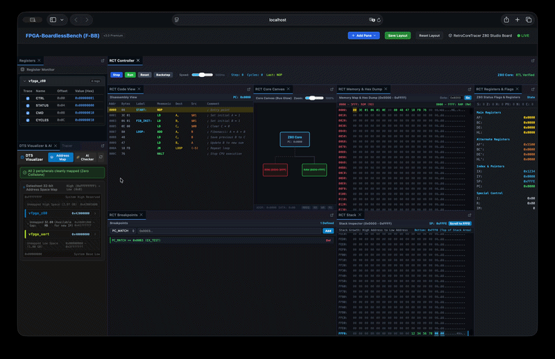
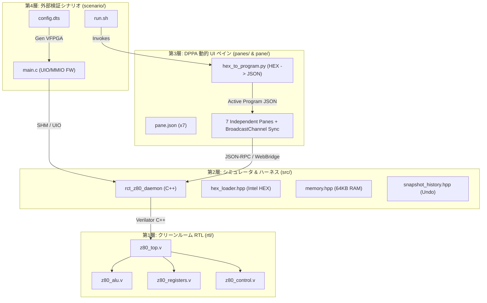

# RetroCoreTracer for F-BB (RetroCoreTracer-FBB)

**RetroCoreTracer-FBB** は、[FPGA-BoardlessBench (F-BB)](https://github.com/sirosiro/FPGA-BoardlessBench) の **PPA 5.1 (Peripheral Plugin Architecture)** および **DPPA v1.0 (Dashboard Pane Plugin Architecture)** を実証・ドッグフーディングするために開発された、外部独立型の Z80 CPU RTL ビジュアルトレーサー＆スタジオプラグインです。

クリーンルーム（完全スクラッチ）から設計された Verilog-2001 Z80 CPU コア、C++ サイクルシミュレータ、決定論的タイムトラベル（Undo / Backstepping）エンジン、動的 Intel HEX デコーダ、および Dockview に自由に配置可能な 7 個の独立した動的 UI ペイン（DPPA）を提供します。F-BB 本体のコードを 1 行も変更することなく、完全なプラグアンドプレイを実現しています。



---

## 主な特徴 (Key Features)

1. **クリーンルーム自作 Verilog-2001 RTL (100% MIT ライセンス)**:
   - 既存の GPL / LGPL 実装（TV80 や T80 等）に一切依存せず、ゼロベースから命令デコーダ・ALU・レジスタファイルを構築。知的財産権の懸念がなく、教材・商用利用にも最適です。
   - バス光彩（Bus Glow）用プローブピンおよびスナップショット状態復元ポート（Undo ポート）をハードウェアレベルでネイティブ装備。

2. **決定論的タイムトラベル (Backstepping / Undo)**:
   - リングバッファによる `SnapshotHistory` を備え、命令サイクルごとの全レジスタ・フラグ・バス信号・PC を完全保存。
   - 実行済みのサイクルを過去方向へ巻き戻すバックステップ（タイムトラベル実行）をサポート。

3. **リアルタイム Bus Glow (バス光彩アニメーション)**:
   - MREQ, IORQ, RD, WR, M1 などの制御信号およびアドレス/データバスの活性状態を SVG で動的に可視化。
   - ズームイン/アウト・リセット機能を備えたインタラクティブなコア・キャンバス。

4. **DPPA v1.0 準拠 7 分割マルチペイン・スタジオ UI & 統合ペイン**:
   - `BroadcastChannel ('fbb_rct_sync')` および共有ステートストアを介して、全ペインが完全リアルタイムに双方向同期。
   - **RCT Controller (Top Toolbar)**: Step, Backstep, Run, Stop, Reset, クロック周波数（スピード）調整スライダー。
   - **RCT Code View**: 構造化逆アセンブルリスト（Addr, Bytes, Label, Mnemonic, Dest, Src, Comment）と実行中 PC 行の追従ハイライト。
   - **RCT Core Canvas**: Bus Glow SVG 動的バス光彩アニメーション、インタラクティブ・ズーム操作。
   - **RCT Registers & Flags**: メインレジスタ (AF, BC, DE, HL)、裏レジスタ (AF', BC', DE', HL')、インデックス (IX, IY)、特殊レジスタ (SP, PC, I, R, IM)、各フラグ (S, Z, H, PV, N, C)、更新ハイライトバッジ（`[POPPED]`, `[LOADED]` 等）。
   - **RCT Stack**: Z80 規約準拠スタックポインタ（初期値 `0x0000` / プレデクリメントにより `0xFFFE..0xFFFF` に配置）、プッシュ・ポップ・サブルーチン呼出階層追従、リアルタイム Hex/ASCII インスペクタ。
   - **RCT Memory Map & Hex Viewer**: 64KB メモリアドレス空間の領域別カラービジュアライザおよびリアルタイム Hex / ASCII ダンプビュー。
   - **RCT Breakpoints**: PC アドレス一致（PC_MATCH）等のブレークポイント登録・管理・ヒット時自動停止。

5. **高精度 Z80 命令ステッピング＆動的 HEX 解析エンジン**:
   - `scripts/hex_to_program.py` により、任意の Intel HEX ファイルから直接 16 ビットアドレス、オペコードバイト列、ニーモニック、分岐オフセットを自動デコード。
   - ラベル優先検索・16進絶対アドレスパース・相対オフセット厳密計算 `(PC + 命令長 + offset) & 0xFFFF` を備えた高精度分岐エンジン（`JR`, `JP`, `DJNZ`, `CALL`, `RET`）。
   - スタック操作（`PUSH`, `POP`）および ALU 演算（`ADD`, `SUB`, `INC`, `DEC`）の完全なフラグ・レジスタ連動。

6. **F-BB コア非侵襲アーキテクチャ (Zero Core Modification)**:
   - `~/.fbb/plugins/fbb-plugin-rct-z80` のシンボリックリンクにより F-BB 側にプラグインとして自動登録。
   - `bin/fbb plugin list`、`bin/fbb plugin validate`、`bin/fbb test`、および `./start_lab.sh` からシームレスに認識・起動。

---

## 4層アーキテクチャ (4-Layer Architecture)



- **第1層: ハードウェア RTL 層 (`rtl/`)**: Verilog-2001 準拠の Z80 プロセッサコア。Verilator によるサイクル精度シミュレーションを前提に最適化。
- **第2層: シミュレータ＆ハーネス層 (`src/`)**: 64KB RAM、Intel HEX パーサ、スナップショット履歴バッファ、UNIX ソケット / JSON-RPC 通信デーモン。
- **第3層: DPPA 動的ペイン層 (`panes/`, `pane/`, `scripts/`)**: F-BB ダッシュボードの Dockview にホットマウントされる React ESM コンポーネント群（7 分割ペイン＋統合ペイン）および動的逆アセンブルスクリプト。
- **第4層: 外部検証シナリオ層 (`scenario/`)**: F-BB の Device Tree (`config.dts`)、C-Shim、UIO ドライバと連携するエンドツーエンド検証環境。

---

## ディレクトリ構成 (Directory Structure)

```text
RetroCoreTracer-FBB/
├── ARCHITECTURE_MANIFEST.md    # 憲法・設計マニフェスト (ADR #001〜#003 収録)
├── CMakeLists.txt              # Verilator RTL + C++ ハーネス統合ビルド定義
├── fbb-plugin.json             # F-BB PPA 5.1 プラグインマニフェスト
├── README.md                   # 本ドキュメント
├── rtl/                        # クリーンルーム Verilog RTL
│   ├── README.md               # RTL アーキテクチャ・ステートマシン仕様書
│   ├── z80_top.v               # トップモジュール (プローブピン・Undoポート)
│   ├── z80_alu.v               # 8-bit ALU (S/Z/H/PV/N/C 完全フラグ演算)
│   ├── z80_registers.v         # レジスタファイル (裏レジスタ・IX/IY・プローブ)
│   └── z80_control.v           # 命令デコーダ & サイクル実行ステートマシン
├── src/                        # C++ シミュレーションハーネス & デーモン
│   ├── hex_loader.hpp          # Intel HEX ファイルパーサ
│   ├── memory.hpp              # 64KB 同期 RAM モデル
│   ├── snapshot_history.hpp    # 決定論的タイムトラベル用リングバッファ
│   ├── z80_daemon.hpp / .cpp   # JSON-RPC / テレメトリデーモン
│   └── main.cpp                # スタンドアロン CLI エントリポイント
├── panes/                      # DPPA v1.0 7 分割マルチペイン群
│   ├── rct-controller/         # 実行制御・クロックスピード調整ペイン
│   ├── rct-code-view/          # 構造化逆アセンブラ・PC追従ペイン
│   ├── rct-registers/          # レジスタ・フラグ・変更バッジインスペクタ
│   ├── rct-stack/              # スタック階層・Hex/ASCII ポップインスペクタ
│   ├── rct-memory/             # 64KB メモリマップ・Hex ビューア
│   ├── rct-canvas/             # Bus Glow SVG コアキャンバスペイン
│   └── rct-breakpoints/        # ブレークポイント管理・自動停止ペイン
├── pane/                       # DPPA v1.0 4 カラム統合スタジオ UI (単一ペイン版)
│   ├── pane.json               # 統合ペインメタデータマニフェスト
│   └── index.js                # 統合スタジオ UI (ESM React)
├── scripts/                    # ユーティリティスクリプト
│   └── hex_to_program.py       # Intel HEX 構造化逆アセンブラ & JSON 生成
├── scenario/                   # F-BB 外部検証テストシナリオ
│   ├── config.dts              # Device Tree (Z80 UIO & UART 定義)
│   ├── main.c                  # シナリオ検証ファームウェア (MMIO)
│   ├── CMakeLists.txt          # シナリオビルド設定
│   ├── run.sh                  # シナリオ起動ランナースクリプト
│   └── vfpga_device_config.h   # IntelliSense / clangd 用事前生成ヘッダー
└── examples/                   # テスト用 Z80 プログラム群 (Intel HEX)
    ├── fibonacci.hex           # フィボナッチ数列計算デモ (ループ・相対ジャンプ)
    ├── z80_loop_test.hex       # DJNZ ループカウンタ検証テスト
    ├── z80_stack_test.hex      # PUSH/POP/CALL/RET スタック呼出検証テスト
    ├── z80_long_program.hex    # 長大プログラム連続実行テスト
    ├── z80_sample.hex          # 基本命令動作確認サンプル
    └── z80_test_01_bit_block_cycle.hex # ビット・ブロック転送サイクル検証
```

---

## コード規模統計 (cloc)

プロジェクト全体の純粋なプログラム規模（Pure LOC: コメント・空行を除いた実コード行数）の測定結果です（`cloc . --exclude-dir=build,node_modules,dist,obj_dir,.git,.vscode,.gemini,brain,scratch,assets` による計測）。

```text
-----------------------------------------------------------------------------------
Language                         files          blank        comment           code
-----------------------------------------------------------------------------------
JavaScript                           8            522            119           6784
Verilog-SystemVerilog                4             88             62            651
Markdown                             4            107              0            426
Python                               2             54             17            389
JSON                                10              0              0            357
C++                                  2             46              9            277
C/C++ Header                         5             46             11            262
CMake                                2             11              0             60
Bourne Shell                         1              9              6             54
C                                    1             11              1             46
-----------------------------------------------------------------------------------
SUM:                                39            894            225           9306
-----------------------------------------------------------------------------------
```
*(ドキュメント Markdown 等を含む総行数は 10,425 行)*

---

## ビルド & 実行方法 (Usage)

### 1. スタンドアロンでのビルドと単体テスト
Verilator と CMake を使用して、RTL のコンパイルおよびシミュレータバイナリをビルドします。

```bash
cd <RetroCoreTracer-FBBのディレクトリ>
cmake -B build
cmake --build build
```
ビルド完了後、`bin/rct_z80_daemon` が生成されます。

### 2. 単体セルフテスト（前進実行＆Backstepping）の確認
```bash
./bin/rct_z80_daemon --test
```
フィボナッチ数列プログラムのロード、前進クロックステップ実行、およびバックステップ（Undo）による過去状態復元がコンソール上で検証されます。

### 3. F-BB へのプラグイン認識と仕様検証
F-BB の統一 CLI を使用してプラグインの認識状況と適合性を確認します。

```bash
cd <FPGA-BoardlessBenchのディレクトリ>

# プラグイン一覧の表示 (Hybrid / Ready (Binary) として表示されます)
bin/fbb plugin list

# PPA プラグイン仕様検証
bin/fbb plugin validate ../RetroCoreTracer-FBB

# DPPA 動的ペイン仕様検証 (統合ペイン)
bin/fbb plugin validate ../RetroCoreTracer-FBB/pane

# DPPA 動的ペイン仕様検証 (各マルチペイン)
bin/fbb plugin validate ../RetroCoreTracer-FBB/panes/rct-code-view
bin/fbb plugin validate ../RetroCoreTracer-FBB/panes/rct-stack
bin/fbb plugin validate ../RetroCoreTracer-FBB/panes/rct-registers
bin/fbb plugin validate ../RetroCoreTracer-FBB/panes/rct-controller
bin/fbb plugin validate ../RetroCoreTracer-FBB/panes/rct-memory
bin/fbb plugin validate ../RetroCoreTracer-FBB/panes/rct-canvas
bin/fbb plugin validate ../RetroCoreTracer-FBB/panes/rct-breakpoints
```

### 4. F-BB テストランナーによるエンドツーエンド検証
F-BB のシミュレーションフレームワーク（C-Shim + Verilator + MMIO）を通じてシナリオを自動実行します。

```bash
bin/fbb test ../RetroCoreTracer-FBB/scenario/
```

### 5. Web ダッシュボードによるインタラクティブ実行
統合ランナーを起動し、ブラウザからビジュアルトレーサーを使用します。`start_lab.sh` の第2引数に対象の `.hex` ファイルを指定することで、任意の Z80 プログラムを Code View およびシミュレータへ即時ロードして実行可能です。

```bash
# 1. 任意の HEX ファイル（ループテスト）を指定して起動
./start_lab.sh ../RetroCoreTracer-FBB/scenario/ examples/z80_loop_test.hex

# 2. スタック・サブルーチン呼出テストを指定して起動
./start_lab.sh ../RetroCoreTracer-FBB/scenario/ examples/z80_stack_test.hex

# 3. 引数を省略した場合は、デフォルトでフィボナッチ数列デモ (fibonacci.hex) が起動します
./start_lab.sh ../RetroCoreTracer-FBB/scenario/
```

ブラウザで `http://localhost:8080` を開き、上部メニューの「Add-ons & Robotics」または「Custom Panes」から **RetroCoreTracer** の各ペイン（または統合スタジオペイン）を選択すると、Dockview 上にリッチスタジオ UI が展開され、指定したプログラムの逆アセンブラ行・レジスタ・スタック・メモリが自動同期されます。

---

## ライセンス (License)

本プロジェクトは **MIT License** の下で公開されています。商用・非商用問わず、誰でも自由に改変・再配布・利用することが可能です。
